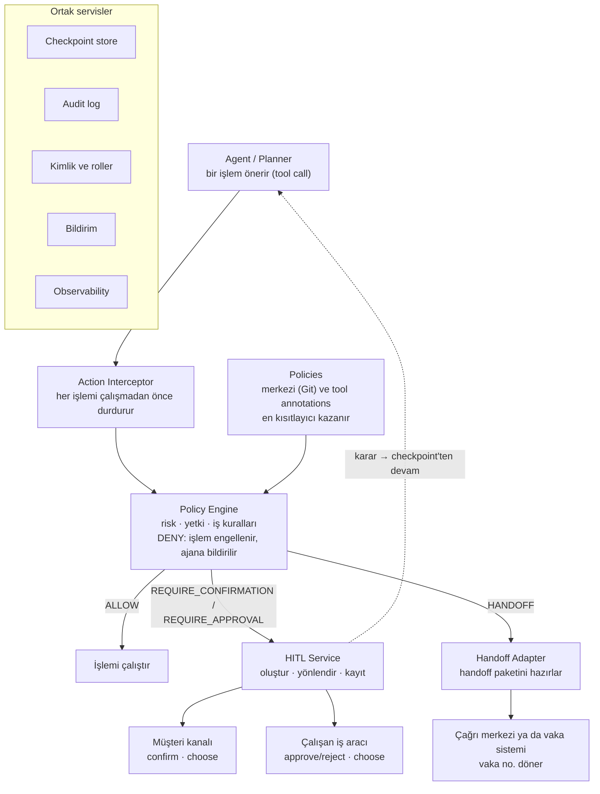
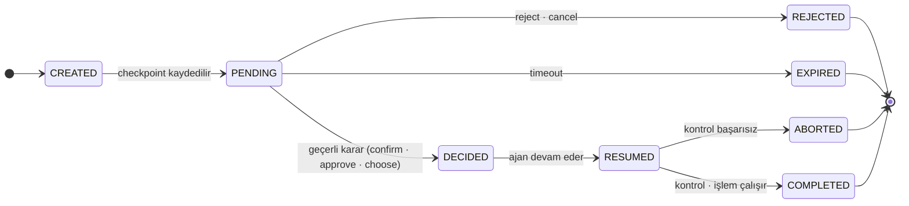

# Getting Started with Create React App

This project was bootstrapped with [Create React App](https://github.com/facebook/create-react-app).

## Available Scripts

In the project directory, you can run:

### `npm start`

Runs the app in the development mode.\
Open [http://localhost:3000](http://localhost:3000) to view it in the browser.

The page will reload if you make edits.\
You will also see any lint errors in the console.

### `npm test`

Launches the test runner in the interactive watch mode.\
See the section about [running tests](https://facebook.github.io/create-react-app/docs/running-tests) for more information.

### `npm run build`

Builds the app for production to the `build` folder.\
It correctly bundles React in production mode and optimizes the build for the best performance.

The build is minified and the filenames include the hashes.\
Your app is ready to be deployed!

See the section about [deployment](https://facebook.github.io/create-react-app/docs/deployment) for more information.

### `npm run eject`

**Note: this is a one-way operation. Once you `eject`, you can’t go back!**

If you aren’t satisfied with the build tool and configuration choices, you can `eject` at any time. This command will remove the single build dependency from your project.

Instead, it will copy all the configuration files and the transitive dependencies (webpack, Babel, ESLint, etc) right into your project so you have full control over them. All of the commands except `eject` will still work, but they will point to the copied scripts so you can tweak them. At this point you’re on your own.

You don’t have to ever use `eject`. The curated feature set is suitable for small and middle deployments, and you shouldn’t feel obligated to use this feature. However we understand that this tool wouldn’t be useful if you couldn’t customize it when you are ready for it.

## Learn More

You can learn more in the [Create React App documentation](https://facebook.github.io/create-react-app/docs/getting-started).

To learn React, check out the [React documentation](https://reactjs.org/).

### Code Splitting

This section has moved here: [https://facebook.github.io/create-react-app/docs/code-splitting](https://facebook.github.io/create-react-app/docs/code-splitting)

### Analyzing the Bundle Size

This section has moved here: [https://facebook.github.io/create-react-app/docs/analyzing-the-bundle-size](https://facebook.github.io/create-react-app/docs/analyzing-the-bundle-size)

### Making a Progressive Web App

This section has moved here: [https://facebook.github.io/create-react-app/docs/making-a-progressive-web-app](https://facebook.github.io/create-react-app/docs/making-a-progressive-web-app)

### Advanced Configuration

This section has moved here: [https://facebook.github.io/create-react-app/docs/advanced-configuration](https://facebook.github.io/create-react-app/docs/advanced-configuration)

### Deployment


AI Human-in-the-Loop (HITL): Ekip Başlangıç Dokümanı
26 Ekim 2026 · Kübra Usluca
Bu doküman ne için?
Bu doküman, HITL üzerinde çalışacak ekibin ortak bir başlangıç noktası. Amacı üç şey:
Aynı dili konuşmak: HITL derken neyi kastettiğimizi, hangi karar türlerini ve senaryoları desteklediğimizi netleştirmek.
Sınırı çizmek: İlk fazda neyi yapıp neyi şimdilik yapmayacağımızı belirlemek.
İşe başlamak: Açık soruları ve ilk adımları ortaya koymak.
Bu bir son karar dokümanı değil. Tasarım ilerledikçe güncelleyeceğiz; netleşen kararlar daha sonra resmi mimari dokümana taşınacak.
Dokümanda kurumsal ve teknik terimleri (Action Interceptor, Policy Engine, checkpoint gibi) İngilizce bıraktık; ekip içinde ve kodda bu adlarla konuşacağız.
Neden HITL?
Ajanlarımız artık sadece soru cevaplamıyor, işlem de yapıyor: kart bloke ediyor, itiraz açıyor, teklif gönderiyor. Bu işlemlerin bir kısmını bir LLM'in tek başına yapmasını istemeyiz. LLM ne kadar emin görünürse görünsün yanılabilir, yanlış anlayabilir ya da manipüle edilebilir. Bankacılıkta bazı kararların da yetkili bir kişi tarafından verilmesi ve kayıt altına alınması zaten zorunlu.
Bugün bu ihtiyaç her ajanda farklı çözülüyor ya da hiç çözülmüyor. Prompt'a "kartı kapatmadan önce müşteriye sor" yazmak güvence değil: model bu talimatı atlayabilir.
HITL ile bunu framework seviyesinde çözmek istiyoruz: ajan ne yapmak istediğini söyler, framework bir insanın devreye girmesi gerekip gerekmediğine karar verir. Gerekiyorsa ajanı durdurur, doğru kişiye sorar, kararı kaydeder ve ajanı sadece o kararla devam ettirir.
Bankacılıktan birkaç örnek:
Durum	Kim karar verir?
"Kartınızı geçici olarak kapatayım mı?"	Müşteri onaylar
"Hangi kartınızdaki harcamadan bahsediyorsunuz?"	Müşteri seçer
250.000 TL'lik kredi teklifinin gönderilmesi	İlişki yöneticisi onaylar ya da reddeder
Hassas segmentteki bir müşterinin dolandırıcılık şikayeti	Vaka doğrudan çağrı merkezine devredilir
İlk fazda ne yapıyoruz?
İlk fazda küçük ama sağlam bir temel kurmayı hedefliyoruz: üç karar türü ve üç senaryo.
Yapacağımız:
Karar türleri: confirm, approve/reject, choose.
Senaryolar: customer interaction, human decision/approval, human handoff.
Policy tabanlı kontrol: Her işlem çalışmadan önce policy'lere göre kontrol edilecek.
Pause / resume: Ajan karar noktasında duracak, durumu kaydedilecek ve karardan sonra kaldığı yerden devam edecek.
Karar ekranı için context: Karar verecek kişi "Onaylıyor musunuz?" sorusunun ötesinde, ne yapılacağını, nedenini ve riskini görecek.
Timeout ve denetim: Her isteğin bir süre sınırı olacak, her karar kayıt altına alınacak.
Şimdilik yapmayacağımız:
Diğer karar türleri: modify (işlemin parametrelerini değiştirmek), escalate (isteği bir üst role taşımak) ve serbest metin girdisi. Müşterinin serbest metin cevabı normal bir sohbet adımı olarak işlenecek.
Human-on-the-loop: İşlem çalıştıktan sonra örneklemeyle ya da izleyerek yapılan inceleme.
Çok adımlı onay zincirleri: Örneğin sıralı iki onaylayıcı.
Yeni bir onay ekranı: Çalışanlar mevcut araçlarını kullanacak.
A2A task'ı içinde HITL (`INPUT_REQUIRED`, `AUTH_REQUIRED`).
Daha geniş agent governance: Harcama limitleri, kill switch, veri policy'leri. HITL'i ileride bu yapıya oturacak şekilde tasarlıyoruz.
Karar türleri
Üç karar türümüz var. Confirm ile approve/reject arasındaki farkı netleştirmek önemli, çünkü ikisi de "onay" gibi görünüyor:
Confirm: İşlem kimin için yapılıyorsa o kişi, genelde müşteri, "evet, bunu istiyorum" der.
Approve/reject: Bankanın adına yetkisi olan biri, genelde bir çalışan, "bu işlem yapılabilir" ya da "yapılamaz" der.
Karar türü	Kişiye sorulan	Kim karar verir?	Olası cevaplar	Örnek
Confirm	"Bunu yapmamı istiyor musunuz?"	İşlemin sahibi (genelde müşteri)	`confirm`, `cancel`	"Kartınızı geçici olarak kapatayım mı?"
Approve / Reject	"Ajan bunu yapabilir mi?"	Gerekli role sahip kişi (genelde çalışan)	`approve`, `reject` (gerekçeyle)	Limit üzeri ödeme, hassas müşteriye kredi teklifi
Choose	"Hangisini yapayım?"	Müşteri ya da çalışan	Sabit bir listeden bir seçenek	"Hangi kartınızdan bahsediyorsunuz?"
Her üçü için ortak kurallar:
Olası cevaplar isteğin içinde tanımlı. Listede olmayan bir cevap kabul edilmez.
Choose seçenekleri yapılandırılmış değerlerdir (bir ID ve bir etiket). LLM'in önerdiği seçenekler gösterilmeden önce, seçilen değer de kullanılmadan önce framework tarafından doğrulanır.
Reject bir gerekçe kodu gerektirir. Serbest metin yorum isteğe bağlıdır; denetim için saklanır ama ajana talimat olarak iletilmez.
Müşterinin cancel cevabı da çalışanın reject kararı da işlemi sonlandırır. Ajan sonucu öğrenir ve işlemi yapmadan sohbete devam eder.
Üç senaryo
Senaryoları ayıran üç soru var: insan kim, ne kadar bekliyoruz ve ajan sonrasında devam ediyor mu?
	Customer interaction	Human decision / approval	Human handoff
İnsan kim?	Sohbetteki müşteri	Gerekli role sahip çalışan	Bir ekip (çağrı merkezi, back office)
Karar türleri	Confirm, choose	Approve/reject, choose	Yok; vakanın sahibi değişir
Bekleme süresi	Saniyeler, dakikalar	Dakikalar, saatler	Yok
Kanal	Müşterinin o an kullandığı kanal (mobil, internet şubesi, chat)	Çalışanın mevcut iş aracı (inbox, vaka ya da iş akışı sistemi)	Mevcut vaka ya da çağrı merkezi sistemi
Sonrasında ajan	Aynı sohbette devam eder	Checkpoint'ten devam eder	Durur; vaka ajan için kapanır
Timeout olursa	İptal	İptal, müşteri bilgilendirilir	—
Customer interaction
Örnek: Müşteri tanımadığı bir harcamayı bildiriyor, ajan kartı kapatmayı öneriyor.
Ajan "kart **** 1234'ü bloke et" işlemini önerir.
Action Interceptor policy'ye sorar. Sonuç: müşteriden confirm alınmalı.
Framework ajanın turunu bir HITL isteğiyle bitirir. Kanal bunu LLM'in yazdığı bir metin olarak değil, butonlu yapılandırılmış bir soru olarak gösterir.
Müşterinin cevabı aynı sohbetin bir sonraki adımı olarak gelir.
Framework cevabı doğrular, işlemi yeniden kontrol eder ve çalıştırır (ya da iptal eder).
Ajan sonuçla sohbete devam eder.
Müşteri düşünürken ajan beklemez; durumu kaydedilir ve müşterinin cevabı onu yeniden başlatır. Hassas onaylarda kanal ek kimlik doğrulaması (step-up) isteyebilir.
Human decision / approval
Örnek: Ajan 250.000 TL'lik bir kredi teklifi göndermek istiyor.
Policy eşleşir (tutar limitin üzerinde). Sonuç: `relationship_manager` onayı gerekli.
Framework checkpoint'i kaydeder ve HITL Service'te bir istek oluşturur.
Müşteriye talebin incelemede olduğu söylenir; ajanın turu biter.
HITL Service isteği ilişki yöneticisinin iş aracına yönlendirir ve bildirim gönderir.
İlişki yöneticisi karar context'ini görür; onaylar, reddeder ya da seçer.
HITL Service karar verenin kimliğini ve rolünü kontrol eder, kararı kaydeder ve ajanı checkpoint'ten devam ettirir.
Framework işlemi yeniden kontrol eder ve çalıştırır (ya da sonlandırır).
Sonuç müşteriye bildirim kanalıyla iletilir.
Human handoff
Ajan durur ve vakayı bir insan devralır. Handoff şu durumlarda olur:
Bir policy gerektiriyorsa (örneğin hassas segmentteki bir müşterinin dolandırıcılık şikayeti),
bir istek reddedildiyse ya da zaman aşımına uğradıysa ve vakanın takibi gerekiyorsa,
ajan işi tamamlayamıyorsa (örneğin tekrarlanan hatalardan sonra),
müşteri bir insanla görüşmek istiyorsa.
Framework bir handoff paketi hazırlar: neden, özet, yapılandırılmış vaka verisi ve sohbet referansı. Handoff Adapter hedef sistemde bir vaka açar ve vaka numarasını döner. Ajan müşteriye bir temsilcinin devam edeceğini, vaka numarasıyla birlikte söyler. Vaka ajan için kapanır. Özet LLM tarafından üretildiği için böyle işaretlenir; vaka verisi ise sistemden gelir.
Nasıl çalışacak?
Temel fikir şu: ajan ne yapmak istediğini söyler, framework bir insanın devreye girip girmeyeceğine karar verir. Her işlem çalışmadan önce Action Interceptor'dan ve Policy Engine'den geçer. Çıkan sonuca göre işlem ya çalışır, ya HITL Service'e gider ya da devredilir.

Bekleyen bir ajan kaynak tüketmez: checkpoint'i kaydedilir, karar geldiğinde yeni bir çalışma olarak kaldığı yerden devam eder.
Bileşenler:
Bileşen	Ne yapar?
Agent / Planner	İşlemleri tool call olarak önerir. Kendi içinde onay mantığı yoktur.
Action Interceptor	Her işlemi çalışmadan önce durdurur, Policy Engine'e sorar ve sonucu uygular. Ajan duracağı zaman checkpoint'i kaydeder.
Policy Engine	Merkezi policy'leri ve tool annotation'ları değerlendirir, tek bir sonuç döner.
HITL Service	İstekleri saklar, doğru kişiye ve kanala yönlendirir, timeout'ları takip eder, kararları doğrular ve kaydeder, ajanı devam ettirir.
Kanal adaptörleri	Müşteri kanalında butonlu soruyu gösterir; çalışanın iş aracında görev açar; cevabı HITL Service'e iletir.
Handoff Adapter	Handoff paketini hazırlar ve hedef sistemde vaka açar.
Ortak servisler	Checkpoint store, audit log, kimlik ve roller, bildirim, observability.
Bu yapı HITL araştırma dokümanındaki 5 katmanlı mimarinin (Agent, Action/Tool Layer, Policy Engine, Execute/Human, Review Service) ilk faz için somutlaştırılmış hali. Fark olarak handoff ayrı bir kol olarak eklendi ve Review Service, kanallarla konuşan HITL Service'e dönüştü.
İnsanın ne zaman devreye gireceğine kim karar veriyor?
Bu kararı LLM değil, policy veriyor. Policy Engine, işlemin kendisine ve bağlamına bakar; LLM'in yazdığı metne değil.
Policy neye bakar?
İşlem bilgisi: Tool contract'taki risk seviyesi, geri alınabilir olup olmadığı, veri hassasiyeti.
İşlem parametreleri: Tutar, para birimi, hedef hesap gibi.
Bağlam: Hangi ajan, hangi kanal, müşteri segmenti, kimlik doğrulama seviyesi.
Ajan sinyalleri: Varsa ajanın confidence değeri.
Olası sonuçlar: Birden fazla kural eşleşirse en kısıtlayıcı olan kazanır.
Öncelik	Sonuç	Ne olur?
1 (en sıkı)	`DENY`	İşlem çalışmaz, ajana bildirilir.
2	`HANDOFF`	İşlem çalışmaz, vaka devredilir.
3	`REQUIRE_APPROVAL`	Ajan durur; bir çalışan onaylar, reddeder ya da seçer.
4	`REQUIRE_CONFIRMATION`	Ajan durur; müşteri onaylar ya da seçer.
5	`ALLOW`	İşlem çalışır.
Araştırma dokümanındaki `NOTIFY`, `LIMIT`, `REDACT` ve `REVIEW` (sonradan inceleme) gibi sonuçlar daha geniş agent governance yapısının parçası; ilk fazda yok.
Policy'ler nereden gelir?
Tool annotation'ları: Geliştirici tool'unu işaretler, örneğin `risk: high`, `requires: confirmation`. Kolay ama merkezi bir policy'yi gevşetemez.
Merkezi policy'ler: Risk, uyum ve iş birimleri tarafından yazılır, Git'te tutulur, onaylanarak yayına alınır. Doğrunun kaynağı bunlardır.
Örnek policy:
```yaml
policy:
  id: LOAN_OFFER_HIGH_VALUE
  version: 3
  owner: retail-credit-risk
  scope:
    agent: lending-agent
    action: send_offer
  trigger:
    any:
      - amount: ">50000"
      - confidence: "<0.6"
      - customer_segment: vulnerable
  outcome: REQUIRE_APPROVAL         # DENY | HANDOFF | REQUIRE_APPROVAL | REQUIRE_CONFIRMATION | ALLOW
  decision:
    type: approve_reject            # confirm | approve_reject | choose
    reviewer:
      role: relationship_manager
      separation_of_duties: true    # isteği başlatan onaylayamaz
  context:
    show: [proposed_action, rationale, evidence, risk, triggered_policy]
  timeout:
    duration: 4h
    on_timeout: cancel              # cancel | handoff
  audit:
    required: true
```
Bir HITL isteğinin yaşam döngüsü
Bir HITL isteği az sayıda durumdan geçer. İşlemi sadece geçerli bir karar ve ardından yapılan son kontrol çalıştırır; diğer tüm yollar işlem çalışmadan biter.

Durum	Anlamı
CREATED	Policy bir HITL sonucu döndü, istek oluşturuldu.
PENDING	Checkpoint kaydedildi, istek kanalda gösteriliyor. Ajanın çalışması bitti.
DECIDED	Geçerli bir karar geldi: confirm, approve ya da bir seçenek.
RESUMED	Ajan checkpoint'ten, kararla birlikte yeniden çalışıyor.
COMPLETED	İşlem çalıştı, sonuç kaydedildi.
REJECTED	Kişi reddetti ya da iptal etti. İşlem çalışmadı, ajana bildirildi.
EXPIRED	Timeout'a kadar karar gelmedi. Policy'deki `on_timeout` uygulanır: iptal ya da handoff.
ABORTED	Son kontrol başarısız oldu (parametreler değişti ya da işlem artık geçerli değil). Yeni bir istek gerekir.
Pause ve resume nasıl çalışıyor?
Pause: Action Interceptor checkpoint'i kaydeder (sohbet, ajan durumu, bekleyen işlem ve parametrelerinin hash'i) ve ajanın çalışmasını bitirir. Bellekte bekleyen bir şey kalmaz.
Resume: Karar geldiğinde herhangi bir replica'da checkpoint'ten yeni bir çalışma başlar. Karar, çalışmaya yapılandırılmış veri olarak eklenir.
Customer interaction da aynı modeli kullanır: müşterinin cevabı sohbetin bir sonraki adımı olarak gelir ve bekleyen isteği devam ettirir.
Bir kez çalışır: Bir checkpoint sadece bir kez devam ettirilebilir. Pause'dan önce çalışan adımlar tekrar çalışmaz.
Örnek bir HITL isteği (alan adları tasarım sırasında kesinleşecek):
```json
{
  "requestId": "hitl-7f3a9c",
  "scenario": "human_approval",
  "decisionType": "approve_reject",
  "agent": "lending-agent",
  "conversationId": "ctx-4815-0091",
  "checkpointId": "chk-22b1",
  "action": {
    "name": "send_offer",
    "parameters": { "customerRef": "C-4815", "amount": 250000, "currency": "TRY" },
    "parametersHash": "sha256:9e1c..."
  },
  "context": {
    "rationale": "Gelir ve kredi notu teklif kriterlerini karşılıyor.",
    "rationaleSource": "agent",
    "risk": "high_value",
    "triggeredPolicy": { "id": "LOAN_OFFER_HIGH_VALUE", "version": 3 }
  },
  "options": ["approve", "reject"],
  "reviewer": { "role": "relationship_manager" },
  "timeout": { "expiresAt": "2026-10-26T16:00:00+03:00", "onTimeout": "cancel" }
}
```
Vazgeçmeyeceğimiz kurallar
Bu kurallar HITL'in "var olması" ile "güvenli olması" arasındaki farkı belirliyor. Tasarım ve geliştirme sırasında her kararı bunlara göre kontrol edeceğiz.
Kontrol kodda, prompt'ta değil. İşlemin durdurulup durdurulmayacağına runtime karar verir. LLM'in bir talimatı uygulamasına bağlı değildir.
Onay, işlemin kendisine bağlıdır. Onay sadece kişinin gördüğü işlem ve parametreler için geçerlidir. İstek parametrelerin hash'ini taşır, karar da aynı hash'i taşımalıdır. Ajan işlemi değiştirirse onay geçersiz olur.
Karar ekranındaki bilgiler sistemden gelir. Tutar, hesap ve müşteri bilgisi işlemin doğrulanmış parametrelerinden alınır. LLM'in açıklaması ayrı gösterilir ve "ajanın önerisi" olarak işaretlenir. Böylece karar verecek kişi prompt injection ile yanıltılamaz.
Cevap yoksa işlem yok. Timeout'ta istek iptal edilir ya da devredilir; hiçbir zaman otomatik onaylanmaz.
Çalıştırmadan önce tekrar kontrol. Karardan sonra işlemin hâlâ geçerli olduğu kontrol edilir; örneğin işlem zaten iade edilmiş olabilir.
Kararı doğru kişi verir. Müşteri kararı sadece sohbetteki doğrulanmış müşteriden, çalışan kararı sadece istenen role sahip doğrulanmış çalışandan kabul edilir. İsteği başlatan kişi onu onaylayamaz. Hassas onaylarda step-up istenebilir.
Bir istek bir kez karara bağlanır. Sonraki kararlar reddedilir.
Sadece gereken veri gösterilir. Hassas değerler, karar verenin rolü izin vermiyorsa maskelenir.
Her şey kayıt altında. İstek, tetikleyen policy ve versiyonu, her durum değişikliği, karar veren, karar, gerekçe ve işlemin sonucu değiştirilemez şekilde kaydedilir.
Mevcut kanalları kullanırız. Müşteri zaten kullandığı kanalda, çalışan mevcut iş aracında karar verir. Yeni ekran yazmayız.
A2A ile ilişkisi
HITL, A2A protokolünün bir parçası değil; framework'ün bir yetkinliği. A2A sadece ajanlar arası sınırda HITL'in nasıl taşınacağını belirliyor. İlk fazda:
Peer'ı çağırmadan önce HITL: Çağıran ajan için peer çağrısı da bir tool. Bu yüzden çağıran ajanın policy'leri buna da uygulanır.
Peer'ın kullanıcıdan bilgiye ihtiyacı varsa: Peer task'ı bir soruyla tamamlar. Cevap aynı konuşmada (`contextId`) yeni bir task olarak gelir.
Peer'ın kendi çalışanının onayına ihtiyacı varsa: Peer HITL'i kendi içinde çalıştırır ve "incelemede" cevabını bir referansla döner. Sonuç müşteriye peer'ın kendi bildirim kanalıyla ulaşır.
Desteklenmeyen: A2A task'ını girdi ya da onay için bekletmek (`INPUT_REQUIRED`, `AUTH_REQUIRED`). Bu, A2A'nın sonraki fazında kalıcı task store ve push notification ile gelecek. O aşamada HITL'in checkpoint altyapısını ortak kullanmayı hedefliyoruz.
Kim ne yapacak?
HITL sadece bir platform işi değil. Hangi kararın insana gideceğini ve kimin onaylayacağını iş ve risk ekipleri belirlemeden kurulan bir altyapı kullanılmaz.
Kim	Sorumluluğu
Ajan ekipleri	Ajanları ve tool'ları geliştirir, tool contract'larına risk bilgisi ve annotation ekler.
Risk ve uyum	Global policy'leri yazar ve onaylar; denetim ve saklama kurallarını belirler.
İş birimleri	İş kurallarını, onaylayıcı rollerini ve SLA'leri belirler; onay kuyruklarını takip eder.
Platform ekibi	Action Interceptor, Policy Engine, HITL Service, checkpoint store ve adaptörleri geliştirir ve işletir.
Kanal ekipleri	Mobil, internet şubesi ve chat kanallarında yapılandırılmış soru ve cevap akışını sağlar.
Güvenlik / IAM	Müşteri ve çalışan kimlik doğrulamasını, rolleri ve step-up'ı sağlar.
Araç sahipleri	Çalışan iş aracı ve vaka sistemi entegrasyonuna destek verir.
Netleştirmemiz gerekenler
[ ] Çalışan iş aracı: Onaylayıcılar hangi mevcut aracı kullanacak (inbox, vaka yönetimi, iş akışı sistemi)? Bu araç görev oluşturma ve karar alma için API sunuyor mu?
[ ] Handoff hedefleri: Handoff'lar hangi sistemlere gidecek (çağrı merkezi, vaka yönetimi)? Vaka numarası nasıl dönecek?
[ ] Çalışan kimliği ve rolleri: `relationship_manager` gibi roller hangi kimlik sağlayıcı ve rol modelinden gelecek?
[ ] Step-up: Hangi müşteri onayları ek kimlik doğrulaması gerektiriyor? Her kanal hangi yöntemi destekliyor?
[ ] Timeout değerleri: Müşteri istekleri için oturum süresi, çalışan onayları için varsayılan süreler.
[ ] Müşteriye sonuç bildirimi: Sohbet bittikten sonra sonuçlanan bir çalışan onayı, müşteriye nasıl iletilecek?
[ ] Policy Engine: Kendimiz mi yazacağız, yoksa mevcut bir kural ya da policy-as-code motoru mu kullanacağız?
[ ] Checkpoint store: Framework'ün session store'u mu kullanılacak, yoksa ileride A2A background task'larıyla da paylaşılacak ayrı bir kalıcı store mu?
[ ] Denetim kayıtları: Saklama süresi ve yeri.
Önerilen ilk adımlar
İlk kullanım senaryolarını seçmek: Her senaryo için bir gerçek ajan ve bir işlem. Örneğin kart bloke (customer interaction), kredi teklifi (approval) ve dolandırıcılık şikayeti (handoff).
İş birimleri ve risk ekibiyle ilk policy'leri yazmak: Bu senaryolar için hangi koşulda kimin karar vereceğini netleştirmek.
Tool contract'ını tanımlamak: Tool'ların taşıyacağı risk ve HITL bilgisini (risk seviyesi, geri alınabilirlik, veri hassasiyeti) belirlemek.
Action Interceptor ve pause/resume için bir prototip: Önce customer interaction ile başlamak; kalıcı servis gerektirmediği için en hızlı doğrulanabilecek senaryo bu.
Çalışan iş aracı ve handoff hedefi için keşif: Mevcut araçların API'lerini incelemek, entegrasyon seçeneğini belirlemek.
HITL Service ve checkpoint store tasarımı: Prototipten öğrendiklerimizle approval senaryosu için kalıcı yapıyı tasarlamak.
Resmi mimari dokümana geçmek: Netleşen kararları kurumsal şablondaki mimari dokümana ve ADR'lere taşımak.

This section has moved here: [https://facebook.github.io/create-react-app/docs/deployment](https://facebook.github.io/create-react-app/docs/deployment)

### `npm run build` fails to minify

This section has moved here: [https://facebook.github.io/create-react-app/docs/troubleshooting#npm-run-build-fails-to-minify](https://facebook.github.io/create-react-app/docs/troubleshooting#npm-run-build-fails-to-minify)
